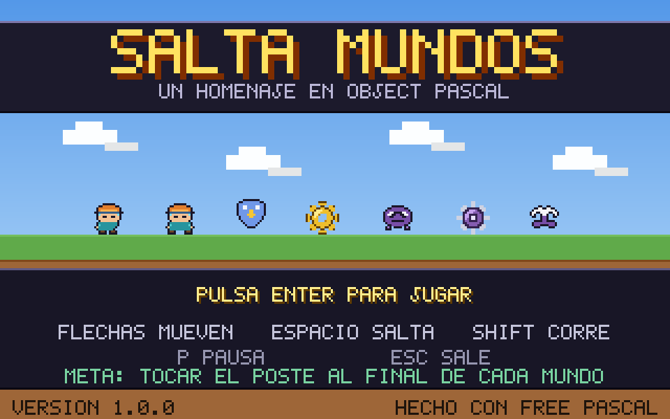
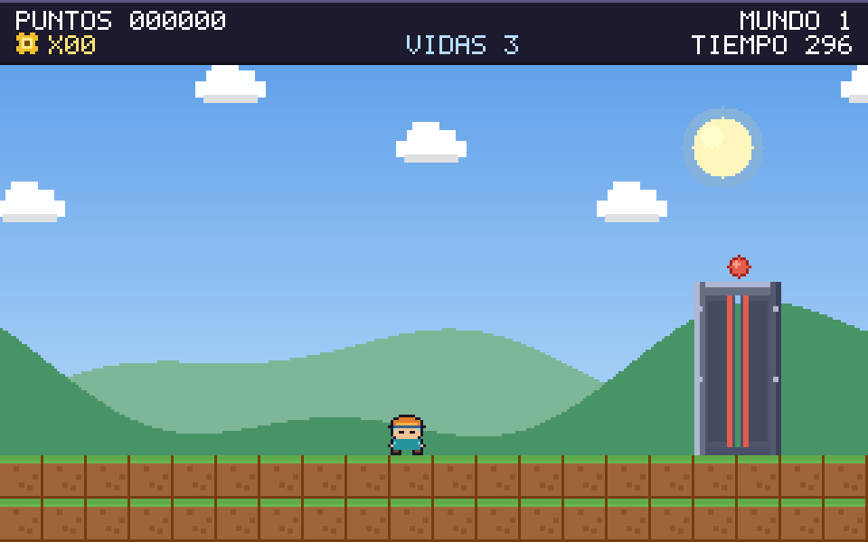
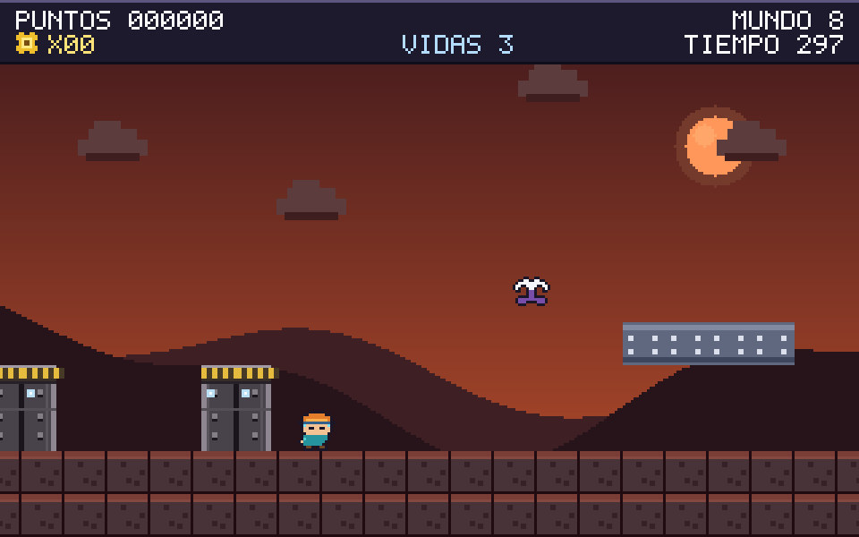
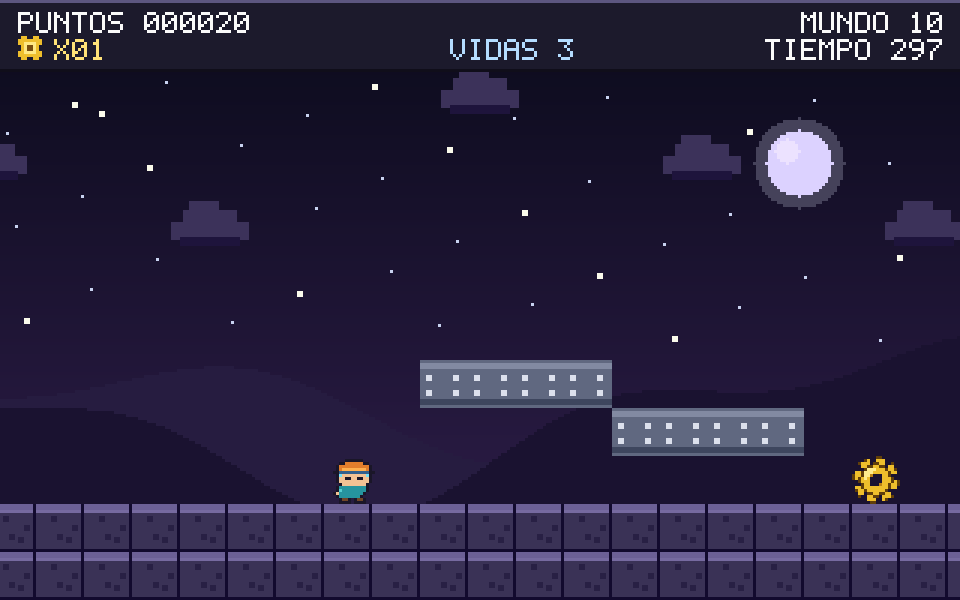

# Salta Mundos

Juego de plataformas 2D de diez niveles, escrito en Object Pascal (modo Delphi) y compilado con Free Pascal para Windows de 64 bits.

Versión 1.1.0 · 22 de noviembre de 2026



## Qué es

Salta Mundos es un juego de plataformas de desplazamiento lateral que se recorre de principio a fin en diez niveles, cada uno con un tema visual propio: pradera, atardecer, noche, cueva, desierto, fábrica, bosque, volcán, hielo y espacio. En cada nivel hay que alcanzar la compuerta de salida antes de que se agote el tiempo, recogiendo tuercas doradas y esquivando o pisando enemigos.

Todo el juego se dibuja a 320x200 píxeles y se escala a la ventana con un múltiplo entero, sin filtros, para conservar el aspecto de pixel art. No se carga ningún archivo de imagen, sonido o mapa: los sprites y los tiles se generan por código, la música y los efectos se sintetizan en tiempo real y los niveles están descritos dentro del ejecutable.

El marcador rotula MUNDO a cada nivel; en este documento se usa «nivel» para referirse a la misma unidad de juego.



## Los diez mundos

| Nivel | Tema | Nivel | Tema |
| --- | --- | --- | --- |
| 1 | Pradera | 6 | Fábrica |
| 2 | Atardecer | 7 | Bosque |
| 3 | Noche | 8 | Volcán |
| 4 | Cueva | 9 | Hielo |
| 5 | Desierto | 10 | Espacio |

Cada tema cambia cielo, colinas, tierra, ladrillos, columnas y el astro del fondo; los mundos 3, 4 y 10 agregan estrellas.





## Características

- Resolución lógica de 320x200 píxeles, escalada a la ventana con un múltiplo entero de 1x a 4x y sin filtros.
- Sprites y tiles generados por código, sin archivos de imagen.
- Música y efectos sintetizados con waveOut a 22050 Hz, mono y 16 bits.
- Sin archivos de datos externos: gráficos, sonido y niveles viajan dentro del ejecutable.
- Diez niveles con paletas, cielos, colinas y decorados propios.
- Salto de altura variable, tiempo de coyote y buffer de salto para un control preciso.
- Autoprueba integrada que se ejecuta sin abrir ventana.
- Compilación reproducible con Free Pascal y publicación automática desde GitHub Actions.

## Controles

| Acción | Teclas |
| --- | --- |
| Mover a la izquierda o a la derecha | Flechas izquierda y derecha, o A y D |
| Saltar | Espacio, flecha arriba, W o Z |
| Correr | Shift o X |
| Pausar y continuar | P |
| Volver al título | Esc |
| Confirmar en el título y en los mensajes | Enter o espacio |

Las teclas de letras se leen por código de tecla, no por carácter, así que funcionan igual con distribución de teclado española o inglesa.

## Reglas

- La partida empieza con 3 vidas y cada nivel dispone de 300 unidades de tiempo. Al llegar a cero se pierde una vida.
- Cada tuerca dorada vale 20 puntos. Cada 100 tuercas se gana una vida extra.
- Pisar un enemigo vale 100 puntos; la púa giratoria no se puede pisar.
- El escudo vale 500 puntos, absorbe un golpe y permite romper ladrillos.
- Al terminar un nivel se suman 10 puntos por cada unidad de tiempo restante.
- Los ladrillos solo se rompen golpeándolos desde abajo con escudo.
- Las cajas con sorpresa se abren desde abajo: entregan tuercas y, cada cuatro cajas golpeadas sin llevar escudo, entregan un escudo.
- Se pierde una vida al tocar un enemigo sin escudo, al caer al vacío o al agotar el tiempo.
- El nivel termina al tocar la compuerta de salida: las dos hojas se abren y el juego pasa al mundo siguiente. Tras el décimo nivel aparece la pantalla de victoria.

## Enemigos

| Enemigo | Comportamiento | Se puede pisar |
| --- | --- | --- |
| Bicho caminante | Patrulla el suelo, gira al chocar con una pared y no se cae de las plataformas | Sí |
| Púa giratoria | Rueda por el suelo y rebota en las paredes | No |
| Mosca voladora | Avanza en zigzag con un vaivén vertical y rebota en las paredes | Sí |

## Cómo compilar

Requisitos: Windows de 64 bits y Free Pascal 3.2.2 o superior, con el compilador cruzado `ppcrossx64.exe` disponible en el `PATH` o con su ruta completa.

1. Abra una consola en la raíz del repositorio.
2. Cree la carpeta de unidades si todavía no existe:

   ```
   mkdir build\units
   ```

3. Compile el programa:

   ```
   ppcrossx64.exe -Mdelphi -O2 -Sh -Fu src -FE build -FU build\units src\SaltaMundos.dpr
   ```

4. Ejecute el binario:

   ```
   build\SaltaMundos.exe
   ```

El resultado esperado es `build\SaltaMundos.exe`. Si el compilador no está en el `PATH`, use su ruta completa, por ejemplo `C:\fpc322\bin\i386-win32\ppcrossx64.exe`.

También se puede compilar desde Lazarus o Delphi creando un proyecto nuevo y agregando los ocho archivos de `src` como units del proyecto. El código usa el modo Delphi y solo depende de la RTL y de las unidades `Windows` y `MMSystem`; no hay bibliotecas de terceros.

En el repositorio, `build.ps1` automatiza estos pasos, crea las carpetas necesarias, compila con optimización y deja el ejecutable en `dist`:

```
./build.ps1 -OutDir dist
```

## Opciones de línea de comandos

| Opción | Efecto |
| --- | --- |
| `--autoprueba` | Ejecuta la prueba interna sin abrir ventana y termina. |
| `--capturar CARPETA` | Guarda `titulo.bmp` y `nivel1.bmp` a `nivel6.bmp`, y termina. |
| `--mapa CARPETA` | Guarda `mapa1.bmp` a `mapa6.bmp` con el nivel completo, y termina. |
| `--nivel N` | Empieza en el nivel N, de 1 a 6. |
| `--silencio` | Desactiva el audio. |
| `--ayuda` | Muestra la ayuda y termina. |

Se aceptan además los alias `--selftest`, `--capture`, `--map`, `--level`, `--mute` y `-h`. Las opciones `--capturar` y `--mapa` no abren ventana: dibujan sobre una superficie en memoria y escriben archivos BMP de 24 bits.

## Estructura del proyecto

```
salta-mundos/
├── .github/
│   └── workflows/
│       ├── compilar.yml       compila y ejecuta la autoprueba en cada push y PR
│       └── publicar.yml       compila y publica el zip en cada etiqueta v*
├── docs/
│   ├── ARQUITECTURA.md        diseño interno del motor
│   └── NOTAS-VERSION.md       notas del release
├── scripts/
│   └── instalar-fpc.ps1       instala Free Pascal 3.2.2 en Windows
├── src/
│   ├── GMCore.pas             constantes, opciones y registro
│   ├── GMSuperficie.pas       superficie de píxeles, fuente y exportación BMP
│   ├── GMVentana.pas          ventana Win32, entrada y presentación
│   ├── GMSprites.pas          paleta, sprites y tiles generados
│   ├── GMNiveles.pas          temas y piezas de los diez niveles
│   ├── GMSonido.pas           sintetizador sobre waveOut
│   ├── GMJuego.pas            estados, física, colisiones y dibujo
│   └── SaltaMundos.dpr        programa principal y opciones de consola
├── tools/
│   ├── hoja.pas               arma una hoja de contactos con todos los sprites
│   └── probar-ventana.ps1     abre el juego y guarda una captura de la ventana
├── build/                     salida de compilación (ignorada por git)
├── build.ps1
├── LEEME.txt
├── LICENSE
└── README.md
```

La captura de portada se publica en `docs/capturas/titulo.png`; la carpeta se crea al agregar la imagen. La carpeta `build` y los binarios están excluidos por `.gitignore`.

## Pruebas

La autoprueba interna valida la estructura de los diez niveles (ancho mínimo, un único punto de inicio y una única compuerta de salida), la física en reposo y en salto, las colisiones contra paredes, una partida automática de 2400 fotogramas, el dibujo de los seis niveles sin ventana, el final de nivel con su paso al mundo siguiente, la muerte con descuento de vida y un recorrido completo con un bot que comprueba que ningún hueco ni pared impide terminar cada uno de los diez mundos. Cada comprobación recibe la condición de error y el resultado se escribe en `salta-mundos.log`, junto al ejecutable, y en la salida estándar.

```
build\SaltaMundos.exe --autoprueba
```

El proceso devuelve código 0 si todas las comprobaciones pasan y 1 si alguna falla. El flujo `compilar.yml` ejecuta esta prueba en cada push a `main` y en cada pull request, y detiene la compilación si el código de salida no es 0.

## Distribución

El flujo `.github/workflows/publicar.yml` se dispara con cada etiqueta `v*`. Compila en `windows-latest` con Free Pascal 3.2.2, ejecuta la autoprueba y publica un release con el archivo `SaltaMundos-<etiqueta>-win64.zip`, que contiene `SaltaMundos.exe`, `LEEME.txt` y `LICENCIA.txt` (copia de `LICENSE`). Las notas del release se toman de `docs/NOTAS-VERSION.md`.

## Licencia

MIT. Copyright (c) 2026 Juan Ruiz. Consulte [LICENSE](LICENSE) para el texto completo.

## Créditos

Programado por Juan Ruiz. Es un homenaje a los juegos de plataformas de la era Turbo Pascal: el código, los gráficos, la música y los niveles son propios. El ejecutable se compila con Free Pascal y no incluye recursos de terceros.
